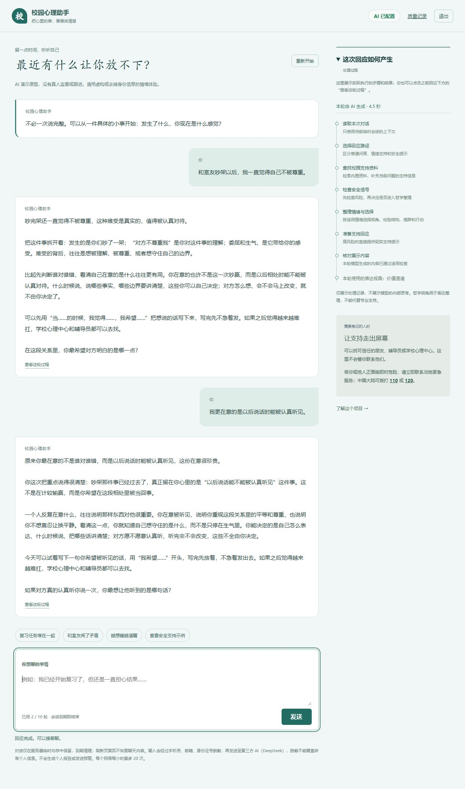

# 校园心理助手 · 哲学情绪翻译

面向学生日常困扰的 AI 体验原型：把发生的事、对事情的理解和当下感受分开，再看见在意的价值、能决定的选择和可以开始的一小步。学生收到自然的聊天段落，内部保留可验证的结构。

[在线体验](https://linjiangqiu.com.cn/mindbridge/) · [工程质量记录](https://linjiangqiu.com.cn/mindbridge/quality.html) · [架构与文件说明](docs/architecture.md) · [改动与产品取舍](docs/product-decisions.md)

> 演示原型，没有真人监看、跟进或自动求助。不提供心理诊断、治疗或急救。请使用虚构或去掉身份信息的情境体验；存在即时危险时联系现实中的人员和当地紧急服务。



## 这次迭代解决什么问题

通用陪伴回复容易停在“理解你、放松一下”。这个版本尝试把支持落到一个学生能继续回答、能自行选择的具体问题上。哲学用于表达整理，不引用名人名言，也不把欺凌、歧视或哀伤解释成“换个心态就好”。

- 独立 `PhilosophyAgent` 节点：只有咨询类、低中风险且原话未命中高风险规则时进入。
- 六类受限视角：价值澄清、控制圈、实用行动、选择、边界与求助、陪伴与哀伤；敏感情境限制可选视角。
- 结构化生成 → 字段、长度、措辞和适用视角校验 → 自然段输出；失败时使用按情境编写的预设回应，并显示来源。
- 临时多轮：随机令牌隔离会话，30 分钟有效、最多 10 轮、单条 1000 字、每 IP 每小时 20 次、全局最多 4 个并发调用。重置上下文不重置配额。
- 可查看实际处理步骤：步骤来自真实 runtime 的 `AgentStep`，包含模型/预设/安全回应来源，不展示模型内部思考。

## 本地运行（Python 3.12）

最小公开体验不需要 MySQL、Redis、向量库或模型权重。使用 SQLite、BM25 词面检索与 mock 模式即可运行。

Windows PowerShell：

```powershell
py -3.12 -m venv .venv
.\.venv\Scripts\Activate.ps1
python -m pip install -r requirements-public.txt
Copy-Item .env.example .env
New-Item -ItemType Directory -Force data | Out-Null
python -c "from pathlib import Path; import secrets; p=Path('.env'); p.write_text(p.read_text(encoding='utf-8').replace('replace-with-a-long-random-secret',secrets.token_urlsafe(48)),encoding='utf-8')"
python -m uvicorn app.main:app --host 127.0.0.1 --port 8080
```

打开 `http://127.0.0.1:8080/`，点击进入即可。体验码 `777` 是公开入口，不是管理密码。空的 `SEED_*_PASSWORD` 在首次建库时产生不可猜测的随机登录密码，不输出密码；公开体验无需管理员登录。

macOS / Linux 使用 `python3 -m venv .venv`、`source .venv/bin/activate`、`cp .env.example .env`，创建 `data` 目录后执行同样的 Python 命令。

### 使用真实 AI

在本地 `.env` 中设置 `AI_PROVIDER=deepseek`、`DEEPSEEK_API_KEY`、`DEEPSEEK_BASE_URL` 和 `DEEPSEEK_MODEL`，然后重启服务。也支持 `openai`（兼容接口）与 `ollama`。密钥只在后端，不能放进前端或提交到 Git。

示例默认保留 `deepseek-chat` 兼容配置；模型可用名称以你的 API 供应商为准。服务端缺少密钥、超时、返回空内容/截断内容或校验失败时会兜底，页面会注明；“已配置”只表示配置存在，本轮是否成功以处理过程中的来源为准。

### Docker

```powershell
docker compose -f compose.demo.yml up --build
```

仍需先创建 `.env` 和随机令牌密钥。默认只绑定本机 `127.0.0.1:8080`；公网发布应由反向代理提供 HTTPS。临时对话使用单进程内存，运行一个 Uvicorn worker；重启会清空，扩容到多副本前需要外部 TTL 存储和分布式限流。

## 运行检查

```powershell
python -m unittest discover -s tests
python -m app.harness.runner
```

测试使用 mock、临时 SQLite 和邮件 log，不调用付费模型、不联系真实人员。2026-11-11 本地检查：78 项单元测试、6 组 harness 通过。原 12 条安全基线和新增 24 条哲学规则检查使用合成固定用例。检索 60 条数据在关闭向量时 Recall@4=0.9667，仅代表该词面检索数据集。不能据此宣称心理疗效、真实用户满意度或实际危机识别率。

本次线上合成冒烟中，学业首轮与追问采用模型输出，高风险走安全路径；记录见 [live-smoke-2026-11-11.json](docs/live-smoke-2026-11-11.json)。浏览器关系示例曾触发预设兜底，说明真实模型并非每轮都会通过约束。真实模型的可用性、延迟、兜底率和连续追问质量需要独立评测；不要把 mock 通过率当成模型质量。

## 数据与工具边界

公开 Bearer 体验会话走 `demo_chat.py`：只有临时内存，不创建聊天记录、风险报告、个案、台账、工具审计或通知。手机号、邮箱、身份证号在传给模型前脱敏；其他识别信息可能遗漏，所以请勿输入真实个人/咨询信息。第三方模型可能采用自己的数据保留政策。

原工程链路仍保留 MySQL/SQLite 持久化、Redis 记忆、MCP 六个写入工具、重试/死信和后台查询，用于本地工程验证；它们没有接入公开体验，也没有真实学校人员接收预警。工具调用由确定性的后端流程安排，不能称为模型自主调用 MCP 或自主规划系统。框架是带条件路由的 LangGraph 工作流；没有完成或随包提供模型微调权重。

## 源码与许可

这是整理后的项目代码。公开之前请先补齐 [SOURCE_PROVENANCE.md](SOURCE_PROVENANCE.md) 中的来源信息，区分原有工程、本人设计/修改和 AI 辅助实现。相似仓库的存在不证明来源关系；也不能未经确认就宣称整个基础框架独立原创。尚未确认源码授权，因此本包没有擅自添加一个覆盖全部文件的开源许可证。可以先放私人仓库保存，确认来源和授权后再公开并补许可证。

GitHub 上传见 [docs/github-publishing.md](docs/github-publishing.md)。
