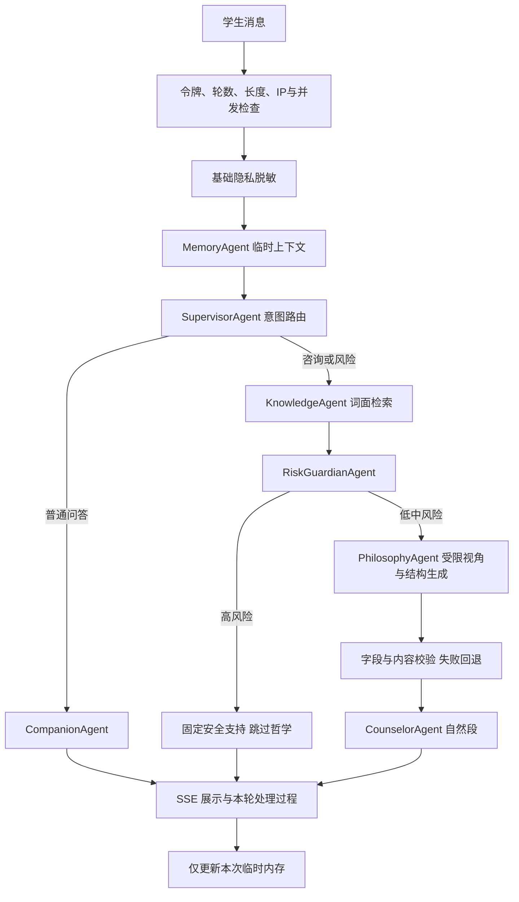

# 架构与文件说明

公开学生端和原来的持久化工程流程共用 Agent 节点，但使用不同的编排入口和记忆适配。

| 路径 | 用途 |
| --- | --- |
| `app/main.py` | FastAPI 启停、种子知识库、静态资源和临时内存清理线程 |
| `app/api/routes.py` | 体验令牌、聊天 SSE、清除会话、状态与后台接口 |
| `app/core/security.py` | Argon2 密码、随机 jti 签名令牌和入口限流 |
| `app/services/demo_chat.py` | 公开会话的隔离、TTL、配额、记忆适配、来源标注和安全回复；不使用持久化 harness |
| `app/agents/runtime.py` | 节点行为、状态字段与自定义有限循环 |
| `app/agents/langgraph_runtime.py` | 相同节点的 LangGraph 条件路由，最多 8 步 |
| `app/services/ai.py` | 模型适配、结构化提示词、DeepSeek/OpenAI/Ollama/mock |
| `app/services/philosophy.py` | 受限视角、适用情境、结构、校验、自然段渲染及按主题兜底；翻译官与校园节点共用 |
| `skills/philosophical_reframing/SKILL.md` | 如何回应：先共情、不诊断、不命令、敏感情境限制和自然表达 |
| `app/services/skills.py` | 根据意图与风险选择技能 |
| `app/services/knowledge.py`、`app/knowledge/*.md` | 说什么：知识切块、BM25/词面检索；向量为可选功能 |
| `app/services/privacy.py` | 手机号、邮箱、身份证号正则脱敏 |
| `app/static/student.html`、`student.js`、`chat.css` | 聊天输入、SSE 解析、历史消息、本轮处理过程、手机布局 |
| `app/static/index.html`、`app.js` | 体验入口与临时令牌 |
| `app/static/quality.*`、`mindbridge-quality.v2.json` | 标注评测条件的工程快照 |
| `app/agents/harness.py`、`services/chat.py` | 原有认证学生的持久化工程链路，公开体验不会调用 |
| `app/mcp_tools/server.py`、`services/tools.py`、`tool_queue.py`、`tool_governance.py` | 能做什么：原有写入工具、重试、死信和治理；不在公开体验启用 |
| `tests/test_philosophy.py`、`tests/test_demo_chat.py` | 哲学路由/校验、多轮隔离、配额、隐私、无写入与适配器回归 |
| `app/services/safety_evaluation.py`、`app/harness/runner.py` | 固定规则用例与六组离线工程链路 |

Skill 是回应规则，知识库是可引用的内容，MCP 是外部工具协议。哲学整理不需要新增一个 MCP 工具：本版本把它实现为共享服务与真实条件节点；既有写入工具继续留在内部工程路径。模型没有自行决定调用这些工具。

处理过程由实际步骤生成，仅展示执行摘要、来源和时间，既不保存完整提示词，也不输出模型内部推理。公开数据存在进程内存中，到期最多延迟 15 秒清理；正在执行的请求完成后再丢弃。部署只运行一个 worker。其他入口（原持久化聊天和独立翻译官）有各自的数据路径，不能把公开聊天的临时策略泛化为整个系统都不保存数据。
